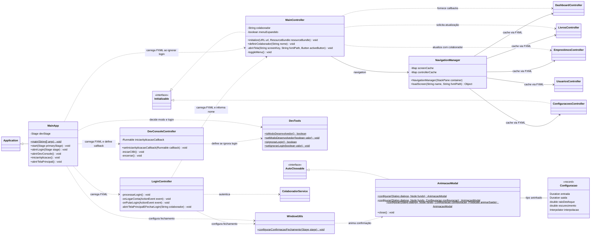
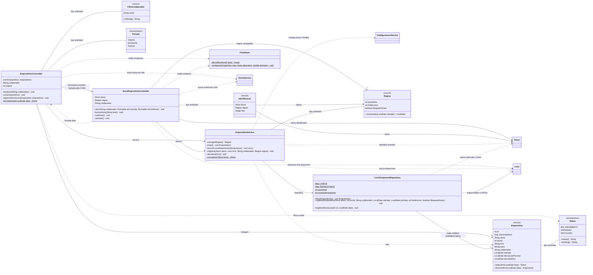
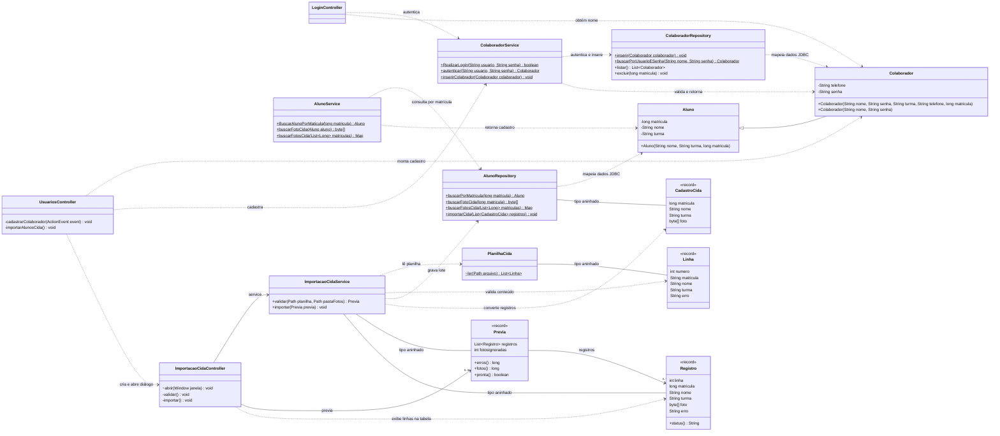
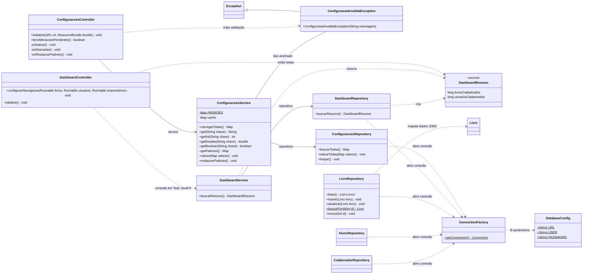

# Diagrama de classes do CIBI

O CIBI é uma aplicação desktop de biblioteca em Java 22 com interface JavaFX e acesso ao MySQL via JDBC. O ponto de entrada definido no [`pom.xml`](../pom.xml) é `com.cibi.application.MainApp`.

O diagrama representa o código atual em [`src/main/java`](../src/main/java), incluindo os 41 tipos de nível superior e os 14 tipos nomeados declarados dentro deles. Os cinco recortes são partes do mesmo modelo. Classes que conectam recortes reaparecem onde são usadas. Os blocos mostram os atributos que explicam o estado e as operações relevantes para cada fluxo. Getters, setters, componentes visuais injetados por FXML e implementações anônimas de `Task` e células de tabela foram omitidos.

**Legenda** — `<|--` indica herança, `<|..` indica implementação de interface, `-->` indica referência mantida em campo ou coleção e `..>` indica uso por chamada, assinatura ou carregamento FXML. A linha sem seta com o rótulo “tipo aninhado” identifica onde o tipo é declarado. `+` indica membro público, `-` indica privado, `~` indica acesso de pacote e `$` identifica membros estáticos no Mermaid. Os atributos de um `record` representam seus componentes. As assinaturas com `Map` foram abreviadas e seus tipos são descritos no texto quando relevantes.

## 1. Inicialização, login e navegação

`MainApp` abre o login ou o console conforme `DevTools`. O console chama de volta a aplicação para continuar a inicialização. No fluxo autenticado, `LoginController` passa a `MainController` o nome retornado por `ColaboradorService`. Sem autenticação, `MainController` mantém o nome inicial “Sessão de desenvolvimento”. `NavigationManager` guarda a raiz visual e o controlador de cada tela pela chave de navegação. O dashboard recebe os callbacks que acionam o menu da janela principal.

`AnimacaoModal<R>` gerencia as transições do diálogo e os efeitos sobre o fundo. Cada instância guarda uma `Configuracao`. A classe implementa `AutoCloseable` para restaurar o estado visual e desvincular os manipuladores ao encerrar seu uso.

## 2. Catálogo de livros e categorias

```mermaid
classDiagram
    direction LR

    class Livro {
        -int id
        -String titulo
        -String autor
        -String sinopse
        -String subtitulo
        -String editora
        -String categoria
        -String isbn
        -Integer anoPublicacao
        -String edicao
        -String volume
        -Integer numeroPaginas
        -String idioma
        -String localPublicacao
        -String assuntos
        -String numeroChamada
        -String localizacao
        -int quantidadeTotal
        -int quantidadeDisponivel
        -String status
        +Livro(Livro outro)
    }
    class LivrosController {
        -List~Livro~ livros
        -List~Livro~ filtrados
        -Map rascunho
        +atualizar() void
        -abrirFormulario(Livro existente) void
        -aplicarFiltros() void
        -excluirLivro(Livro livro) void
        -exportar() void
        ~gerarCsv(List~Livro~ livros) String$
    }
    class LivroFormularioController {
        -Map estadoInicial
        -Map estadoSalvo
        +configurar(Livro existente, Map rascunho, Consumer salvar, Consumer salvarRascunho, Runnable cancelar) void
        +configurarAtualizacaoCategorias(Consumer atualizar) void
        -gerenciarCategorias() void
        -salvar() void
        -salvarRascunho() void
    }
    class GerenciarCategoriasController {
        +configurar(String selecionada, Consumer salvar, Runnable cancelar) void
        -novaCategoria() void
        -renomear() void
        -excluir() void
        -salvar() void
    }
    class ConfirmacaoCategorias {
        ~excluir(VBox gerenciador, String categoria) boolean$
        ~salvar(VBox gerenciador) boolean$
    }
    class AnimacaoModal
    class LivroService {
        +List~String~ STATUS$
        +listarLivros() List~Livro~
        +inserirLivro(Livro livro) void
        +atualizarLivro(Livro livro) void
        +excluirLivro(int id) void
        +validar(Livro livro) void$
        +isbnValido(String valor) boolean$
        +BuscarLivro(Livro livro) Livro$
        +InserirLivro(Livro livro) void$
    }
    class CategoriaLivroService {
        -List~String~ CATEGORIAS$
        +listar() List~String~
        +iniciarEdicao() Edicao
    }
    class Edicao {
        -List~String~ originais
        -List~Item~ itens
        +listar() List~Item~
        +adicionar(String nome) Item
        +renomear(Item item, String nome) Item
        +excluir(Item item) void
        +emUso(Item item) boolean
        +salvar(Item selecionada) Resultado
    }
    class Item {
        <<record>>
        String original
        String nome
        +toString() String
    }
    class Resultado {
        <<record>>
        Map nomesAtualizados
        String selecionada
        +atualizarNome(String nome) String
    }
    class LivroTemporarioRepository {
        +listar() List~Livro~
        +buscarPorId(int id) Livro
        +inserir(Livro livro) void
        +atualizar(Livro livro) void
        +excluir(int id) void
    }

    LivrosController --> LivroService : service
    LivrosController --> "0..*" Livro : livros e filtrados
    LivrosController ..> LivroFormularioController : carrega FXML e fornece callbacks
    LivrosController ..> Resultado : atualiza rascunho
    LivrosController ..> AnimacaoModal : anima confirmação
    LivroFormularioController ..> Livro : monta dados do formulário
    LivroFormularioController ..> LivroService : status e validação
    LivroFormularioController --> CategoriaLivroService : categorias
    LivroFormularioController ..> GerenciarCategoriasController : abre modal FXML
    LivroFormularioController ..> Resultado : atualiza categoria do formulário
    LivroFormularioController ..> AnimacaoModal : anima diálogos
    GerenciarCategoriasController ..> CategoriaLivroService : inicia edição
    GerenciarCategoriasController --> Edicao : edicao
    GerenciarCategoriasController ..> Item : seleciona e edita
    GerenciarCategoriasController ..> Resultado : entrega ao callback
    GerenciarCategoriasController ..> ConfirmacaoCategorias : confirma ações
    ConfirmacaoCategorias ..> AnimacaoModal : anima diálogos
    LivroService --> LivroTemporarioRepository : repository
    LivroService ..> Livro : valida e encaminha
    CategoriaLivroService --> LivroTemporarioRepository : livros
    CategoriaLivroService ..> Livro : obtém categorias do acervo
    CategoriaLivroService -- Edicao : tipo aninhado
    CategoriaLivroService -- Item : tipo aninhado
    CategoriaLivroService -- Resultado : tipo aninhado
    Edicao --> "0..*" Item : itens da edição
    Edicao ..> Resultado : produz ao salvar
    Edicao ..> Livro : atualiza categorias no acervo
    LivroTemporarioRepository --> "0..*" Livro : mapa estático LIVROS
```

`LivrosController` lista, filtra, pagina e exporta o catálogo em CSV. Ao abrir o formulário, fornece callbacks para salvar o livro, guardar o rascunho ou voltar à lista. `LivroService` valida os dados, incluindo ISBN, ano, quantidades e status. Suas operações atuais, inclusive `BuscarLivro` e `InserirLivro`, usam `LivroTemporarioRepository`. O repositório usa cópias de `Livro` nas operações do catálogo.

`Livro.categoria` é uma `String`. `CategoriaLivroService` combina os nomes da lista estática com os nomes encontrados no acervo. O modal mantém uma cópia de trabalho em `Edicao` e aplica as alterações quando o usuário salva. Renomear uma categoria atualiza os livros vinculados, e uma categoria em uso tem a exclusão bloqueada. `Resultado` contém o mapa de nomes antigos para novos e a seleção resultante.

## 3. Empréstimos e devoluções

`NovoEmprestimoController` identifica o aluno por matrícula digitada ou leitor de cartão, consulta as regras em vigor e pesquisa livros com saldo disponível. O registro no repositório verifica o limite de empréstimos ativos e o bloqueio por atraso, quando habilitado. A retirada reduz o estoque e a devolução o repõe. O estoque e o histórico são alterados sob o mesmo bloqueio, compartilhado por todas as instâncias do repositório.

Cada `Emprestimo` registra `matriculaAluno` e `livroId` e copia os nomes do aluno, do livro, do autor e do colaborador. Esses vínculos são representados por valores escalares. Um livro com empréstimo ativo tem a exclusão bloqueada. Depois da devolução, o registro pode permanecer no histórico mesmo se o livro for excluído. `Status` é calculado a partir das datas de vencimento e devolução.

## 4. Alunos, colaboradores e importação CIDA

`Colaborador` herda matrícula, nome e turma de `Aluno`. No banco, `ColaboradorRepository` trabalha com `colaboradores` e `AlunoRepository` com `alunos`. A herança Java é independente da persistência nessas tabelas.

O diálogo CIDA é montado em Java. `PlanilhaCida` lê arquivos `.xlsm` e `.xlsx` como ZIP/XML. `ImportacaoCidaService` valida as linhas, associa fotos JPEG por matrícula e gera as miniaturas que serão gravadas. A tela mostra na prévia o resultado da validação de cada linha. Quando a prévia está pronta, o serviço converte os registros em `CadastroCida` e o repositório grava o lote em uma transação. Na atualização de uma matrícula existente, a foto anterior é preservada se o lote vier sem imagem. A coluna `alunos.foto_cida` é adicionada pela [migração CIDA](../BD/migracao_importacao_cida.sql). As consultas de fotos retornam um mapa de matrículas para bytes JPEG.

## 5. Configurações, painel e infraestrutura JDBC

`ConfiguracoesService` combina os padrões com as configurações armazenadas e mantém um cache por instância. Serviço e repositório usam mapas de chaves e valores textuais. O fluxo de empréstimo consome prazo em dias, limite de livros e bloqueio por atraso.

| Fluxo | Fonte efetiva dos dados |
| --- | --- |
| Cadastro de colaboradores e login | `ColaboradorRepository` acessa a tabela MySQL `colaboradores`. |
| Identificação de aluno e importação CIDA | `AlunoRepository` acessa `alunos`, incluindo a coluna `foto_cida` da migração. |
| Configurações | `ConfiguracoesRepository` lê e grava a tabela `configuracoes`. |
| Catálogo e circulação | `LivroTemporarioRepository` guarda livros e empréstimos em mapas estáticos durante a execução. Os nomes de categorias também ficam em memória, em `CategoriaLivroService`. |
| Dashboard | `DashboardRepository` conta as linhas de `livros` e de `colaboradores` no MySQL. O total chamado “usuários cadastrados” corresponde aos colaboradores. |
| CRUD JDBC de livros | `LivroRepository` mapeia `id`, `titulo`, `autor` e `sinopse` na tabela `livros`. Está implementado sem chamadas nas telas ou serviços atuais. |

Um livro cadastrado pela tela de catálogo altera o acervo em memória e fica fora do total consultado pelo dashboard no MySQL. O dashboard carrega os totais em uma tarefa disparada na inicialização de seu controlador, que depois fica no cache de navegação.

## Vínculos FXML

Os vínculos abaixo vêm dos atributos `fx:controller` dos [arquivos FXML](../src/main/resources/com/cibi/fxml).

| FXML | Controlador | Onde é carregado |
| --- | --- | --- |
| `Tela_Login.fxml` | `LoginController` | `MainApp` |
| `Tela_Principal.fxml` | `MainController` | `LoginController` ou `MainApp` |
| `DevConsole.fxml` | `DevConsoleController` | `MainApp` |
| `pages/Dashboard.fxml` | `DashboardController` | `NavigationManager`, solicitado por `MainController` |
| `pages/Livros.fxml` | `LivrosController` | `NavigationManager`, solicitado por `MainController` |
| `pages/Emprestimos.fxml` | `EmprestimosController` | `NavigationManager`, solicitado por `MainController` |
| `pages/Usuarios.fxml` | `UsuariosController` | `NavigationManager`, solicitado por `MainController` |
| `pages/Configuracoes.fxml` | `ConfiguracoesController` | `NavigationManager`, solicitado por `MainController` |
| `pages/LivroFormulario.fxml` | `LivroFormularioController` | `LivrosController` |
| `pages/GerenciarCategorias.fxml` | `GerenciarCategoriasController` | `LivroFormularioController` |
| `pages/NovoEmprestimo.fxml` | `NovoEmprestimoController` | `fx:include` em `pages/Emprestimos.fxml` |
